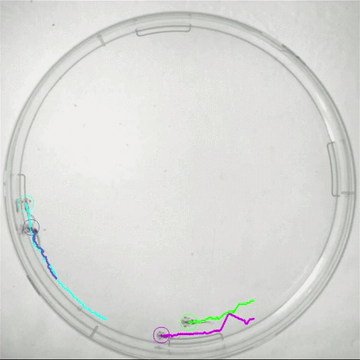
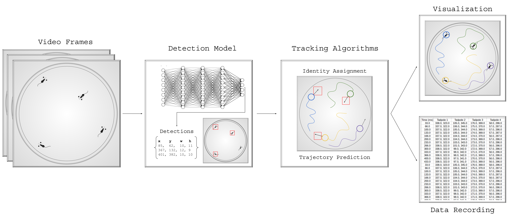

# Tadpole-Tracker
A real-time tracking system that applies computer vision and deep learning to record and analyze movement data of multiple *Xenopus laevis* tadpoles at once for neurobiology research. This is my undergraduate thesis project, conducted in collaboration with the neuroscience department at Bard College.

-----
<!--

-->

 

-----
### Notes

- All the code that performs tracking is called from the SinglePlateTracker class, located [here](src/main/java/sproj/tracking/).

- The thesis paper I wrote for this project is available [here](/paper/senior_thesis.pdf).

- Real-time tracking is capable on a GTX 1070 GPU or better - fps should be around 28-30 with default settings.

-----

### Concepts

- There are two major components of this tracker program: Detection and Tracking.

- **Detection** is the process of finding regions of interest (ROI) in each frame (image) from the video input stream.

- **Tracking** is the process of connecting where each animal was in previous frames to its new position in sequential frames, i.e. connecting ROIs to the corresponding tadpoles. This becomes complicated when tracking multiple animals, because of the potential for collisions and collusions. Therefore, algorithms to handle both identity assignment and trajectory prediction are necessary.

### Components

- Deep convolutional neural networks form the tadpole detection component of the overall system. I trained a CNN model to perform xenopus tadpole detection and localization using my own dataset and the [YOLOv2](https://pjreddie.com/darknet/yolov2/) architecture.

- Linear Kalman filters provide the trajectory estimation and a modified version of the Munkres Hungarian optimal assignment algorithm is used for maintaining unique object identities across frames.

-----

<b>System Overview</b>

  

-----

### Speed Benchmarks

The current iteration of this system runs at ~30 frames/second on a GTX 1070 GPU. Using Java with the DeepLearning4J library provided an overhead speedup in additional to the core algorithmic and model-based improvements evaluated for the paper.
